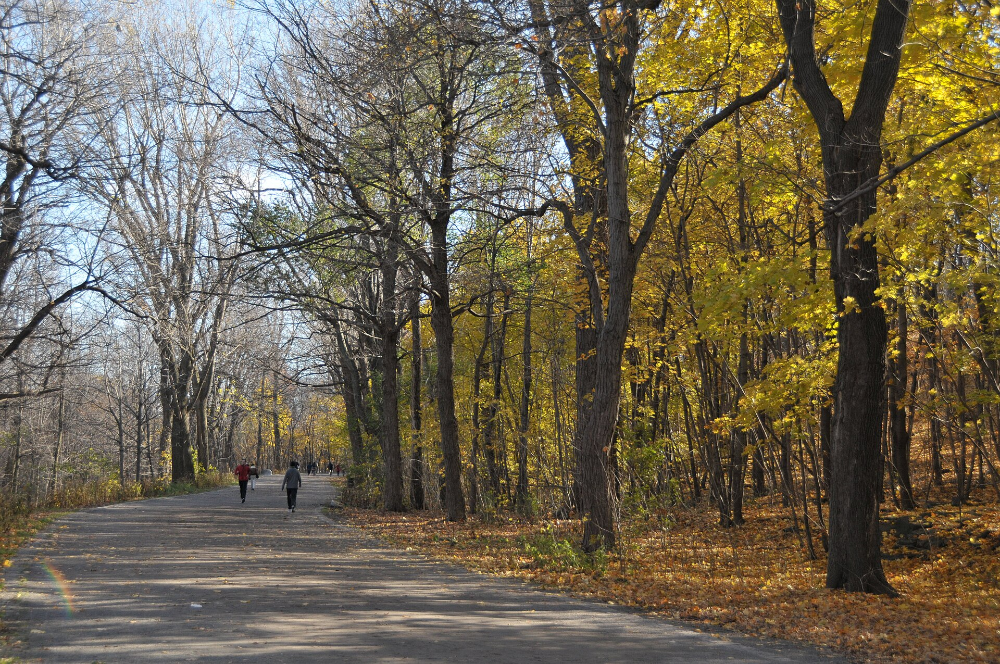

Après deux ans de démarches, le comité environnement du cégep annonce l’arrivée d’une station de vélos en libre-service devant le pavillon principal, au printemps prochain.
La station comptera quinze points d’ancrage. Le cégep financera la moitié des abonnements saisonniers pour les vingt premières personnes inscrites.
<figure class="post-figure"><figcaption>Photo : Serge Melki from Indianapolis, USA / Wikimedia Commons (CC BY 2.0)</figcaption></figure>

Le comité organisera aussi un atelier de mécanique gratuit en avril, pour apprendre à réparer une crevaison et régler ses freins.

